<p align="center">
  
</p>

<p align="center">
  
  
  
  
  
  
</p>

<p align="center">
  <a href="https://www.linkedin.com/in/amr-el-dahshan-843a11306/"></a>
  <a href="https://tryhackme.com/p/amrkhaled171516"></a>
  <a href="https://codeforces.com/profile/Amr_El-Dahshan"></a>
  <a href="https://amr-khaled-ahmed.github.io/Portfolio/"></a>
  <a href="mailto:amrkhaledv2171516@gmail.com"></a>
</p>

---

<div align="left">

```bash
$ whoami
> amr@zeroaccess:~$ Cybersecurity student studying offensive and defensive security: reverse engineering, malware analysis, pentesting, SOC and network security
$ ./expertise.sh --skills
> [Loading complete]: Binary Analysis | Malware Analysis | Pentesting | SOC Triage | Network Security | Tool Development
$ uname -a
> Ultramarine Linux (Fedora 43) | Hyprland | DankMaterialShell
$ ps -aux | grep active-research
> ACTIVE: Custom Security Tools | Reverse Engineering | Malware Analysis | Pentesting | Endpoint Triage
$ echo $PATH | tr ':' '\n' | grep -E "(reverse|tools|compiler)"
> /opt/reverse-engineering-suite/bin
> /opt/custom-security-tools/bin
> /opt/compiler-toolchain/bin
$ cat /etc/passwd | grep contact
> github:Amr-Khaled-Ahmed:x:1000:1000:Cybersecurity Student:/home/amr:/bin/bash
```

</div>

---

## `~ $ cat about.md`

I'm a Computer Science student at **FCAI, Cairo University** (class of 2027) who spends most of his time in a terminal. I study anything related to cybersecurity, red team or blue team, host or network. I like understanding how things work at the lowest level (binaries, processes, the OS, packets) because that's what lets you both break them and defend them properly.

- 🔬 Malware analysis and reverse engineering
- 🛡️ Blue team: SOC, DFIR and threat detection
- 🎯 Red team: recon, pentesting, exploitation
- 🌐 Network security: firewalls, IDS/IPS, VPNs, routing and switching
- 🛠️ Writing small, offline-first security tools
- 🏁 Playing CTFs on TryHackMe, HackTheBox and PicoCTF

---

## `~ $ ls focus/`

<table>
  <tr>
    <td width="33%" valign="top">
      <h3>🔬 Malware Analysis &amp; RE</h3>
      Static and dynamic analysis of binaries, unpacking, behaviour tracing and writing detections.
      <br /><br />
      <code>Ghidra</code> <code>IDA</code> <code>x64dbg</code> <code>PEStudio</code> <code>YARA</code>
    </td>
    <td width="33%" valign="top">
      <h3>🛡️ SOC &amp; DFIR</h3>
      Endpoint triage, log analysis, persistence hunting, phishing analysis and traffic review.
      <br /><br />
      <code>Sysinternals</code> <code>Wireshark</code> <code>Volatility</code> <code>SIEM</code> <code>Sysmon</code>
    </td>
    <td width="33%" valign="top">
      <h3>🎯 Red Team &amp; Pentest</h3>
      Recon, web app testing, vulnerability assessment, exploitation and post-exploitation.
      <br /><br />
      <code>Burp Suite</code> <code>Metasploit</code> <code>Nmap</code> <code>Nessus</code> <code>OSINT</code>
    </td>
  </tr>
  <tr>
    <td width="33%" valign="top">
      <h3>🌐 Network Security</h3>
      Firewall policy design, IDS/IPS, VPNs, segmentation, routing and switching.
      <br /><br />
      <code>FortiGate</code> <code>Palo Alto</code> <code>Snort</code> <code>VLANs</code> <code>OSPF</code>
    </td>
    <td width="33%" valign="top">
      <h3>🐧 Systems &amp; Linux</h3>
      Linux administration, hardening and scripting, plus building security utilities in Python and C/C++.
      <br /><br />
      <code>RHEL</code> <code>SELinux</code> <code>systemd</code> <code>Bash</code> <code>Python</code>
    </td>
    <td width="33%" valign="top">
      <h3>☁️ Cloud &amp; Tooling</h3>
      Cloud security fundamentals, containers and day-to-day dev workflow.
      <br /><br />
      <code>AWS</code> <code>Docker</code> <code>Git</code> <code>GitHub</code> <code>GitLab</code>
    </td>
  </tr>
</table>

---

## `~ $ cat workflow.md`

How I usually approach a suspicious sample:

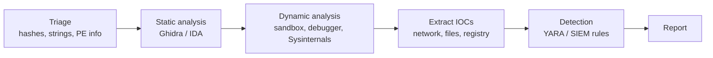

---

## `~ $ cat currently.txt`

```text
[learning ]  malware analysis fundamentals, reverse engineering
[studying ]  Red Hat System Administration (RHCSA path)
[studying ]  AWS cloud security
[practising] SOC 101 workflows, CTF challenges
[building ]  offline-first security tooling in Python
```

---

## `~ $ ls stack/`

### ⚡ Programming & Scripting

<table>
  <tr>
    <td align="center" width="12%"><br /><sub>C</sub></td>
    <td align="center" width="12%"><br /><sub>C++</sub></td>
    <td align="center" width="12%"><br /><sub>Python</sub></td>
    <td align="center" width="12%"><br /><sub>Java</sub></td>
    <td align="center" width="12%"><br /><sub>JavaScript</sub></td>
    <td align="center" width="12%"><br /><sub>HTML</sub></td>
    <td align="center" width="12%"><br /><sub>React</sub></td>
    <td align="center" width="12%"><br /><sub>Django</sub></td>
  </tr>
  <tr>
    <td align="center" width="12%">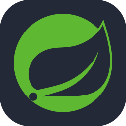<br /><sub>Spring Boot</sub></td>
    <td align="center" width="12%"><br /><sub>Bash</sub></td>
    <td align="center" width="12%">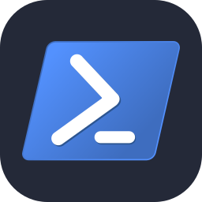<br /><sub>PowerShell</sub></td>
    <td align="center" width="12%">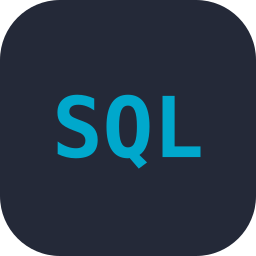<br /><sub>SQL</sub></td>
    <td align="center" width="12%"><br /><sub>Assembly</sub></td>
    <td align="center" width="12%">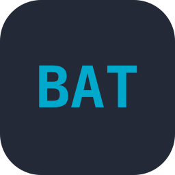<br /><sub>Batch</sub></td>
  </tr>
</table>

**Also:** Assembly x86 / x64 / ARM · Shell Scripting

### 🔬 Reverse Engineering & Malware Analysis

<table>
  <tr>
    <td align="center" width="12%"><br /><sub>IDA Pro</sub></td>
    <td align="center" width="12%"><br /><sub>Ghidra</sub></td>
    <td align="center" width="12%">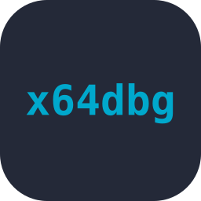<br /><sub>x64dbg</sub></td>
    <td align="center" width="12%">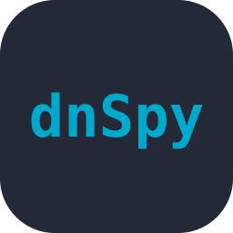<br /><sub>dnSpy</sub></td>
    <td align="center" width="12%"><br /><sub>JADX</sub></td>
    <td align="center" width="12%"><br /><sub>Pwntools</sub></td>
    <td align="center" width="12%"><br /><sub>PEStudio</sub></td>
    <td align="center" width="12%"><br /><sub>DIE</sub></td>
  </tr>
  <tr>
    <td align="center" width="12%">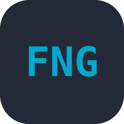<br /><sub>FakeNet-NG</sub></td>
    <td align="center" width="12%">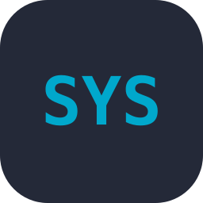<br /><sub>Sysinternals</sub></td>
    <td align="center" width="12%"><br /><sub>YARA</sub></td>
  </tr>
</table>

**Techniques:** Static Analysis · Dynamic Analysis · Anti-Analysis Techniques · Anti-Debug Bypass · Binary Deobfuscation · Kernel Debugging · Exploit Development

### 🛡️ SOC, DFIR & Threat Detection

<table>
  <tr>
    <td align="center" width="12%">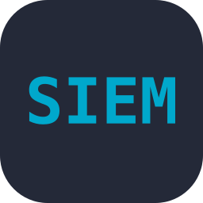<br /><sub>SIEM</sub></td>
    <td align="center" width="12%">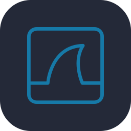<br /><sub>Wireshark</sub></td>
    <td align="center" width="12%">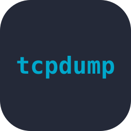<br /><sub>tcpdump</sub></td>
    <td align="center" width="12%"><br /><sub>Snort</sub></td>
  </tr>
</table>

**Techniques:** Incident Response · Digital Forensics · Memory Forensics · Phishing Analysis · Threat Intelligence · Endpoint Monitoring · Network Monitoring · Traffic Analysis

### 🌐 Networking

<table>
  <tr>
    <td align="center" width="12%">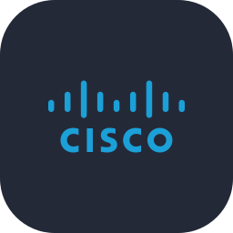<br /><sub>CCNA 200-301 track</sub></td>
    <td align="center" width="12%">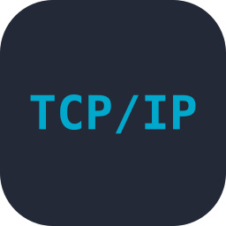<br /><sub>TCP/IP</sub></td>
    <td align="center" width="12%">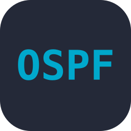<br /><sub>OSPF</sub></td>
    <td align="center" width="12%"><br /><sub>EIGRP</sub></td>
    <td align="center" width="12%">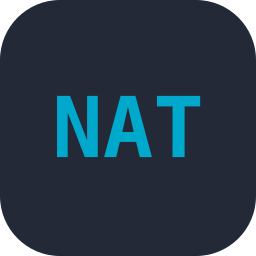<br /><sub>NAT</sub></td>
    <td align="center" width="12%">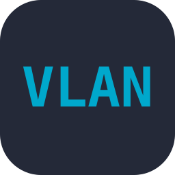<br /><sub>VLANs</sub></td>
    <td align="center" width="12%">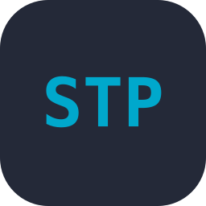<br /><sub>STP</sub></td>
    <td align="center" width="12%">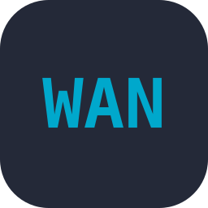<br /><sub>WAN</sub></td>
  </tr>
  <tr>
    <td align="center" width="12%">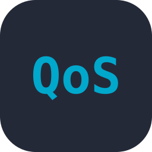<br /><sub>QoS</sub></td>
    <td align="center" width="12%">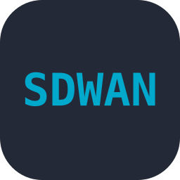<br /><sub>SD-WAN</sub></td>
  </tr>
</table>

**Also:** Routing & Switching

### 🔥 Firewalls & Network Security

<table>
  <tr>
    <td align="center" width="12%">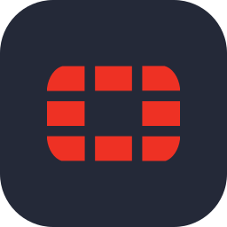<br /><sub>FortiGate 7.6</sub></td>
    <td align="center" width="12%"><br /><sub>FortiManager</sub></td>
    <td align="center" width="12%"><br /><sub>Palo Alto Firewalls</sub></td>
    <td align="center" width="12%">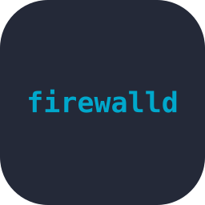<br /><sub>Firewalld</sub></td>
    <td align="center" width="12%">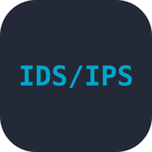<br /><sub>IDS/IPS</sub></td>
    <td align="center" width="12%"><br /><sub>VPN (IPsec/SSL)</sub></td>
  </tr>
</table>

**Concepts:** Threat Protection · Security Policy Design · System Hardening

### 🎯 Penetration Testing & Recon

<table>
  <tr>
    <td align="center" width="12%">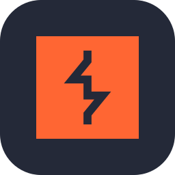<br /><sub>Burp Suite</sub></td>
    <td align="center" width="12%"><br /><sub>Metasploit</sub></td>
    <td align="center" width="12%">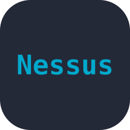<br /><sub>Nessus</sub></td>
    <td align="center" width="12%">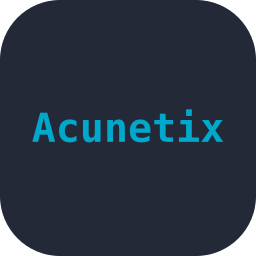<br /><sub>Acunetix</sub></td>
    <td align="center" width="12%"><br /><sub>Nmap</sub></td>
    <td align="center" width="12%">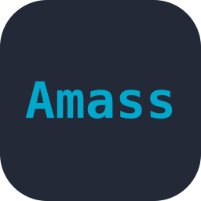<br /><sub>Amass</sub></td>
    <td align="center" width="12%">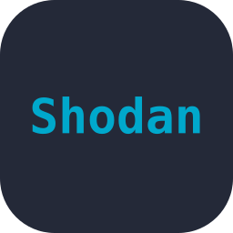<br /><sub>Shodan</sub></td>
    <td align="center" width="12%"><br /><sub>Recon-ng</sub></td>
  </tr>
  <tr>
    <td align="center" width="12%"><br /><sub>theHarvester</sub></td>
    <td align="center" width="12%">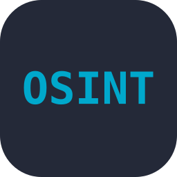<br /><sub>OSINT Framework</sub></td>
  </tr>
</table>

**Techniques:** Web App Testing · Vulnerability Scanning · Vulnerability Assessment · Reconnaissance · Exploitation · Post-Exploitation · Ethical Hacking (CEH track)

### 🐧 Operating Systems & System Administration

<table>
  <tr>
    <td align="center" width="12%"><br /><sub>Linux</sub></td>
    <td align="center" width="12%"><br /><sub>Red Hat</sub></td>
    <td align="center" width="12%"><br /><sub>Fedora</sub></td>
    <td align="center" width="12%">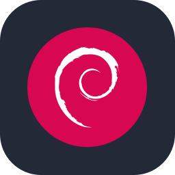<br /><sub>Debian</sub></td>
    <td align="center" width="12%">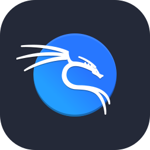<br /><sub>Kali Linux</sub></td>
    <td align="center" width="12%"><br /><sub>Parrot OS</sub></td>
    <td align="center" width="12%"><br /><sub>Windows</sub></td>
    <td align="center" width="12%"><br /><sub>Windows Server</sub></td>
  </tr>
  <tr>
    <td align="center" width="12%">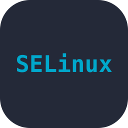<br /><sub>SELinux</sub></td>
    <td align="center" width="12%">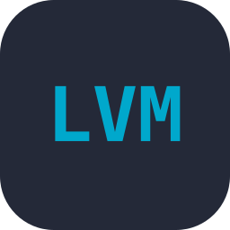<br /><sub>LVM</sub></td>
    <td align="center" width="12%">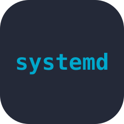<br /><sub>systemd</sub></td>
  </tr>
</table>

**Also:** File Systems & ACLs · User Management · Container Basics · Shell Scripting (RHCSA path)

### ☁️ Cloud, Virtualization & Dev Tools

<table>
  <tr>
    <td align="center" width="12%"><br /><sub>AWS</sub></td>
    <td align="center" width="12%"><br /><sub>Docker</sub></td>
    <td align="center" width="12%"><br /><sub>Git</sub></td>
    <td align="center" width="12%"><br /><sub>GitHub</sub></td>
    <td align="center" width="12%"><br /><sub>GitLab</sub></td>
  </tr>
</table>

**Also:** Cloud & Virtualization

---

## `~ $ git log --stat`

<p align="center">
  
  
</p>

---

<p align="center">
  <a href="https://tryhackme.com/p/amrkhaled171516"></a>
</p>

<div align="center">
  <h3>
    <span>
      <font color="#0D5F1A">
        01001000 01100001 01100011 01101011 00100000 01110100 01101000 01100101 00100000 01110000 01101100 01100001 01101110 01100101 01110100 00100000 01100010 01111001 00100000 01110101 01101110 01100100 01100101 01110010 01110011 01110100 01100001 01101110 01100100 01101001 01101110 01100111 00100000 01101001 01110100
      </font>
    </span>
  </h3>
</div>

<div align="center">
  <h3 style="font-family: 'Arabic Typesetting', serif;">
    وإنْ مُتُّ لم أندمْ، وإن عِشتُ لم أُقمْ<br>
    أُبايعُ من لا يَشرَفُ المالُ كَفَّهُ
  </h3>
</div>


